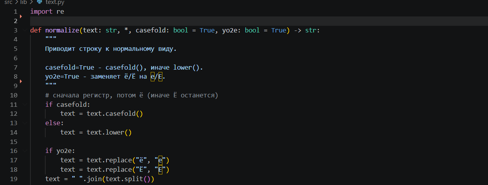
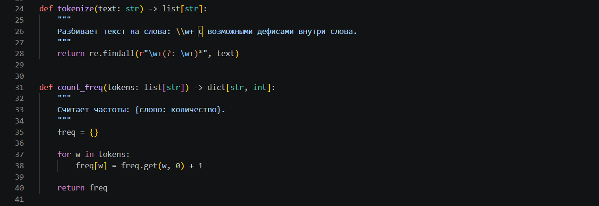
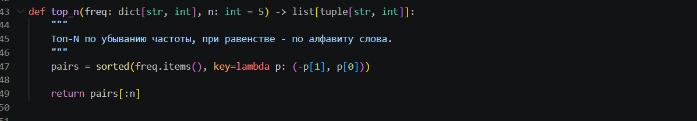
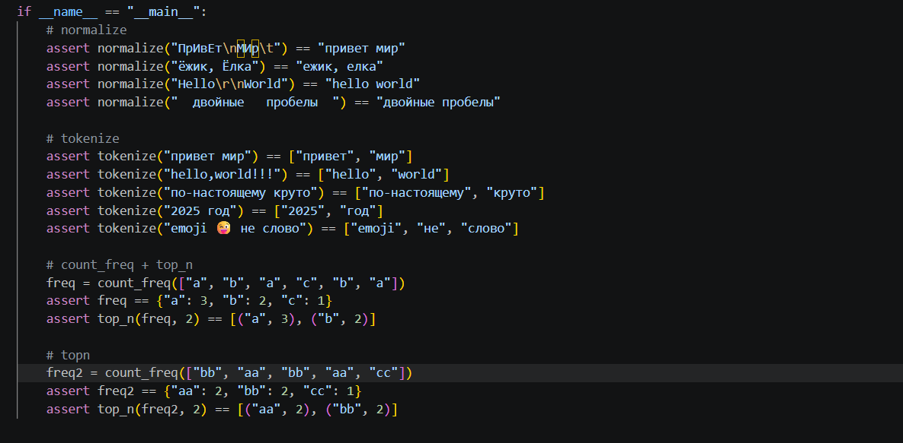
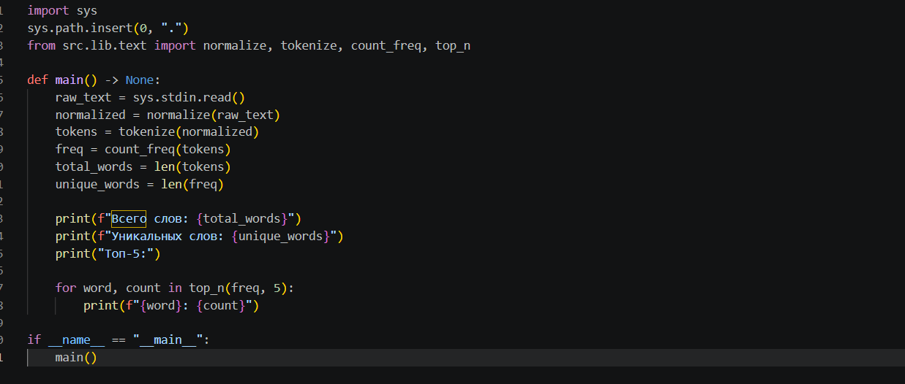

# ЛР3

## Задание A (text.py)
Реализует функции для обработки текста: нормализация (`normalize`: casefold или lower, замена ё на е, замена управляющих символов на пробелы и схлопывание пробелов), разбиение на слова (`tokenize`: шаблон `\w+(?:-\w+)*`, дефис допускается внутри слова), подсчёт частот (`count_freq`) и выбор топ-N слов (`top_n`: по убыванию частоты, при равенстве по алфавиту). Функции в `src/lib/text.py`.

## Задание B (text_stats.py)
Скрипт читает весь ввод  (`sys.stdin.read()`), вызывает функции из `src/lib/text.py` и печатает общее число слов, число уникальных слов и топ-5 в формате `слово: кол-во`. Скрипт в `src/lab03/text_stats.py`.

