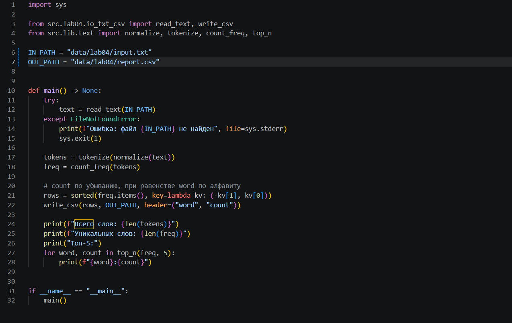
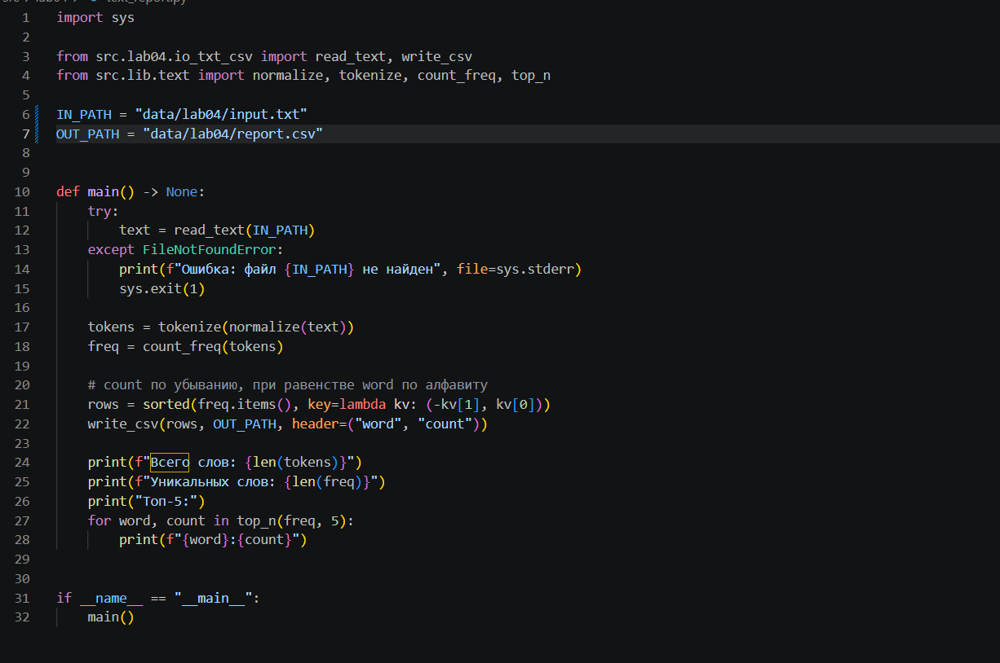
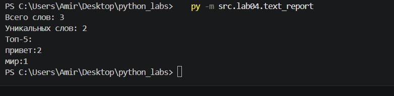
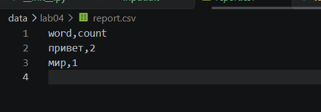

# ЛР4 — чтение текста и отчёт CSV

- `src/lab04/io_txt_csv.py` — `read_text` (чтение файла в строку), `write_csv` (запись CSV), `ensure_parent_dir`
- `src/lab04/text_report.py` — читает `data/lab04/input.txt`, считает частоты слов (функции из ЛР3), пишет `data/lab04/report.csv`, печатает резюме
## io_text_csv

## text report

V
## Запуск

Из корня репозитория:

```
py -m src.lab04.text_report
```

## Допущения

- Пути заданы в коде: вход `data/lab04/input.txt`, выход `data/lab04/report.csv`.
- Кодировка — UTF-8. Другую можно передать: `read_text(path, encoding="cp1251")`.
- Нет входного файла → сообщение в stderr и `sys.exit(1)`.
- Пустой вход → в `report.csv` только заголовок `word,count`.
- Файл читается целиком; для очень больших файлов лучше читать построчно.
- Сортировка отчёта: `count` по убыванию, при равенстве `word` по алфавиту.

## Тест

`data/lab04/input.txt`: `Привет, мир! Привет!!!`

Вывод в консоль:



`data/lab04/report.csv`:

