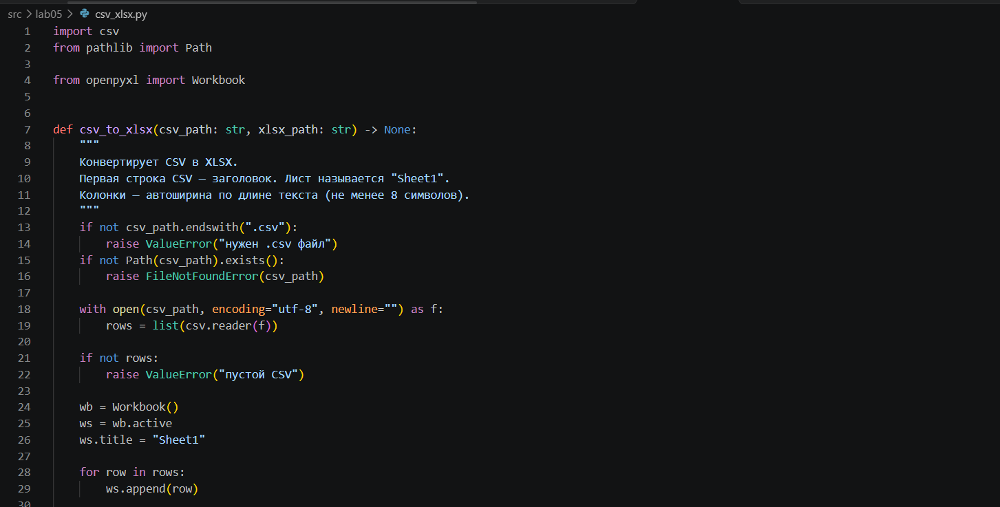
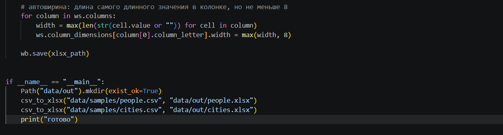
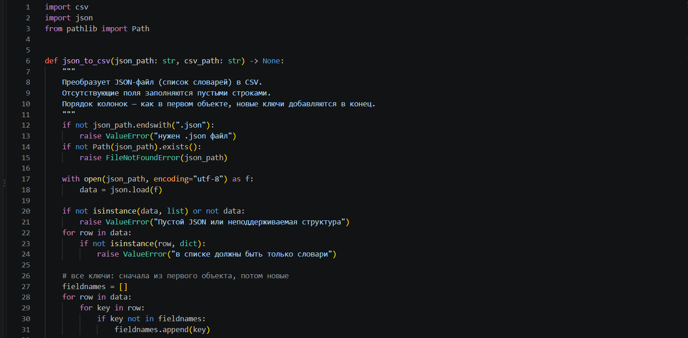
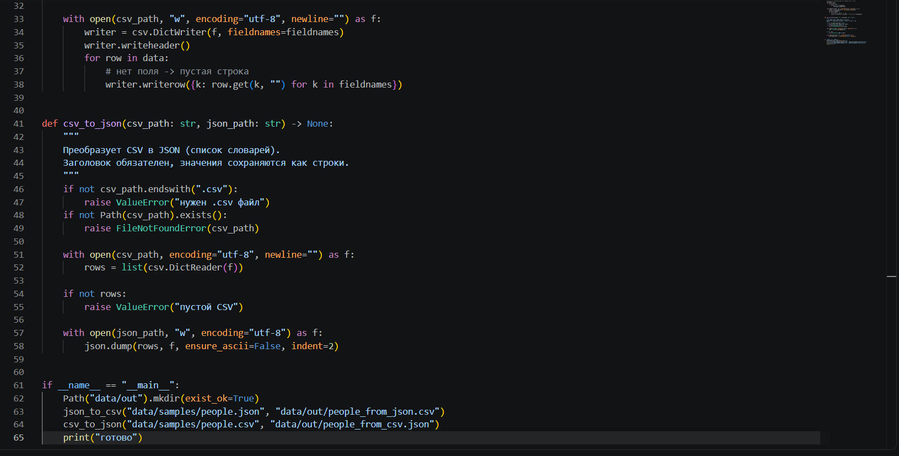
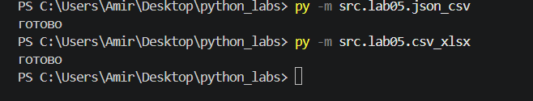
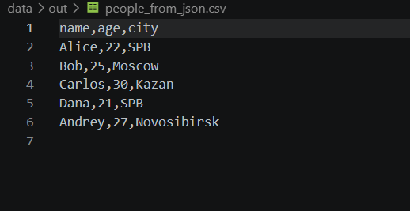
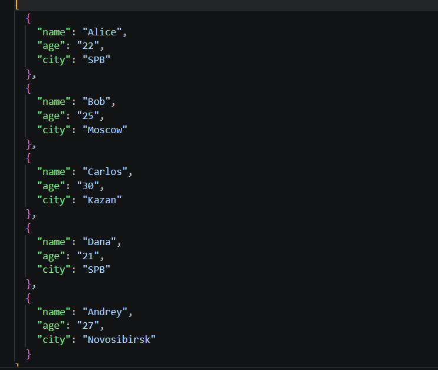
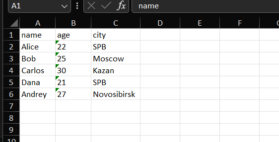
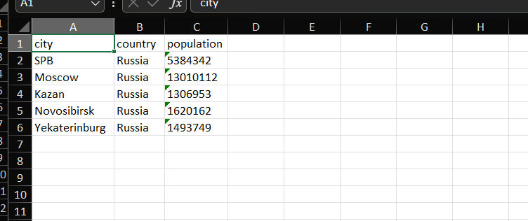

# ЛР5 — JSON ↔ CSV, CSV → XLSX

Модули конвертации данных: `src/lab05/json_csv.py` (JSON ↔ CSV) и `src/lab05/csv_xlsx.py` (CSV → XLSX через openpyxl).

## Установка и запуск

Запуск — из корня репозитория.

```
py -m pip install -r requirements.txt
py -m src.lab05.json_csv
py -m src.lab05.csv_xlsx
```

## Файлы

- `data/samples/` — входные примеры: `people.json`, `people.csv`, `cities.csv`
- `data/out/` — результаты: `people_from_json.csv`, `people_from_csv.json`, `people.xlsx`, `cities.xlsx`


## Код


### `csv_xlsx.py`



### `json_csv.py`




## Допущения

- Кодировка всех файлов — UTF-8.
- Порядок колонок в CSV — как в первом объекте JSON; ключи, которых нет в первом объекте, добавляются в конец в порядке появления.
- Отсутствующие поля заполняются пустой строкой.
- CSV → JSON: все значения сохраняются строками (в CSV нет типов), поэтому `22` становится `"22"`.
- XLSX: лист `Sheet1`, ширина колонки — по самому длинному значению, но не меньше 8 символов.
- openpyxl — единственная внешняя зависимость (`requirements.txt`).

## Обработка ошибок

- Неверное расширение файла → `ValueError`
- Файл не найден → `FileNotFoundError`
- Пустой JSON, `[]` или не список → `ValueError("Пустой JSON или неподдерживаемая структура")`
- В списке не словари → `ValueError`
- Пустой CSV или только заголовок → `ValueError`

## Сценарии проверки

### 1. JSON → CSV

`people.json` → `people_from_json.csv`: заголовок `name,age,city`, количество строк совпадает с количеством объектов.

```
py -m src.lab05.json_csv
```





### 2. CSV → JSON

`people.csv` → `people_from_csv.json`: ключи совпадают с заголовком, количество объектов совпадает с количеством строк.



### 3. CSV → XLSX

`people.csv` → `people.xlsx`, `cities.csv` → `cities.xlsx`. Файлы открываются в Excel, лист `Sheet1`, колонки не уже 8 символов.

```
py -m src.lab05.csv_xlsx
```





