ЛР6 — CLI-утилиты (argparse)

Консольные утилиты для анализа текста и конвертации данных. Используются функции из ЛР3 (src/lib/text.py) и ЛР5 (src/lab05/). Только стандартная библиотека (argparse, sys, pathlib) + ранее написанные функции.

Запуск — из корня репозитория. На Windows вместо python используется py.

Модули и подкоманды
src/lab06/cli_text.py
cat --input <путь> [-n] — выводит файл построчно; с -n — с номерами строк. --input обязателен.
stats --input <путь> [--top N] — топ-N самых частых слов (нормализация и токенизация из ЛР3). --top по умолчанию 5.
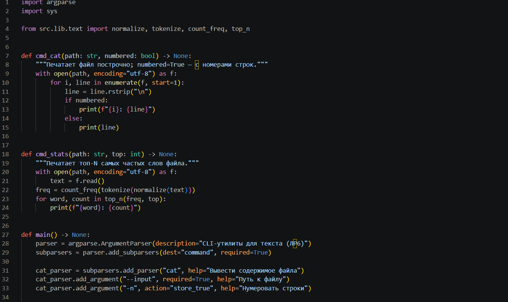
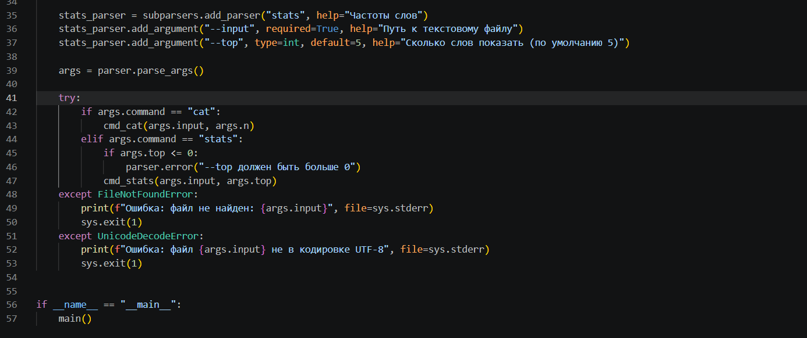
src/lab06/cli_convert.py
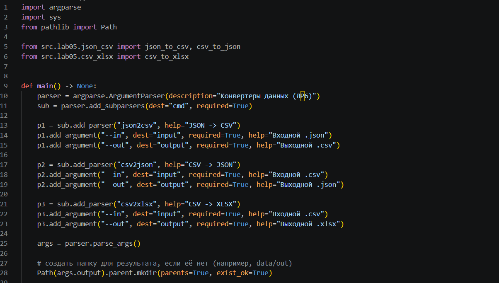
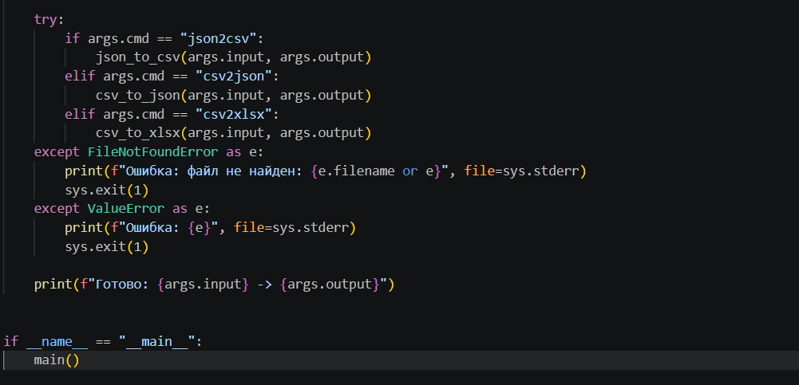
json2csv --in <файл.json> --out <файл.csv> — JSON → CSV
csv2json --in <файл.csv> --out <файл.json> — CSV → JSON
csv2xlsx --in <файл.csv> --out <файл.xlsx> — CSV → XLSX

Все параметры cli_convert обязательны. Папка для результата (data/out/) создаётся автоматически.

Установка
py -m pip install -r requirements.txt

openpyxl нужен для csv2xlsx из ЛР5.

Сценарии проверки
1. Вывод файла с номерами строк
py -m src.lab06.cli_text cat --input data/samples/people.csv -n

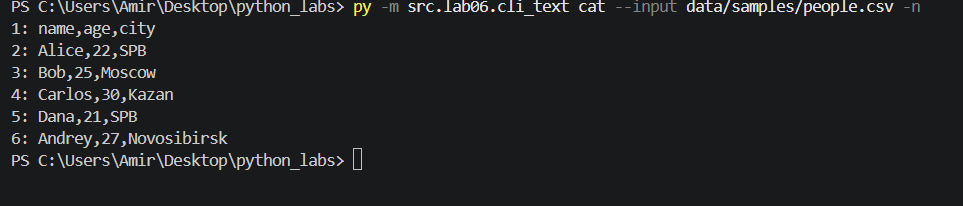

2. Вывод файла без номеров
py -m src.lab06.cli_text cat --input data/samples/people.csv

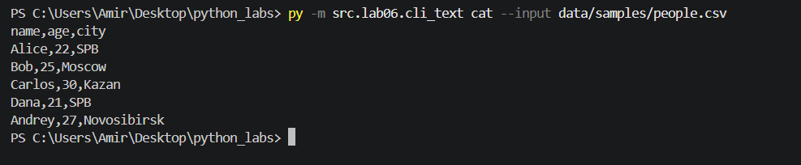

3. Топ-5 слов
py -m src.lab06.cli_text stats --input data/samples/people.txt --top 5

«Ещё», «ещё» и «еще» посчитаны как одно слово — нормализация из ЛР3 (нижний регистр, ё → е).

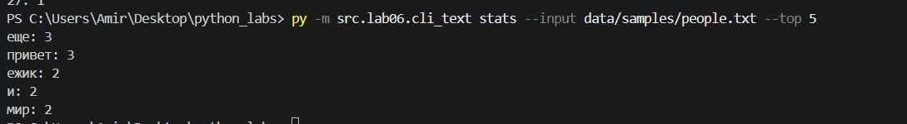

4. Конвертация JSON → CSV, CSV → JSON, CSV → XLSX
py -m src.lab06.cli_convert json2csv --in data/samples/people.json --out data/out/people.csv
py -m src.lab06.cli_convert csv2json --in data/samples/people.csv --out data/out/people.json
py -m src.lab06.cli_convert csv2xlsx --in data/samples/people.csv --out data/out/people.xlsx

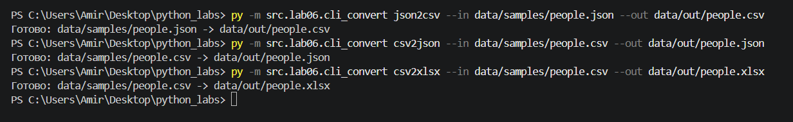

5. Справка по программам
py -m src.lab06.cli_text --help
py -m src.lab06.cli_convert --help

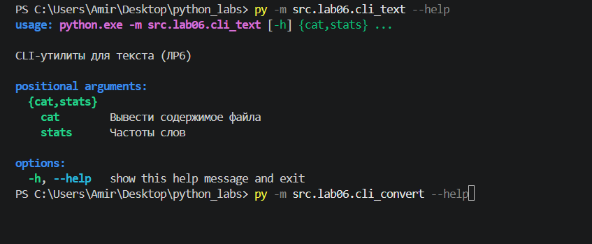

6. Справка по подкомандам
py -m src.lab06.cli_text cat --help
py -m src.lab06.cli_text stats --help

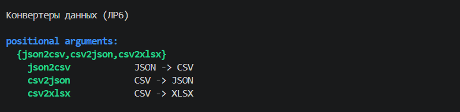

7. Обработка ошибок
py -m src.lab06.cli_text cat --input nope.txt
py -m src.lab06.cli_text cat
py -m src.lab06.cli_text stats --input data/samples/people.txt --top 0

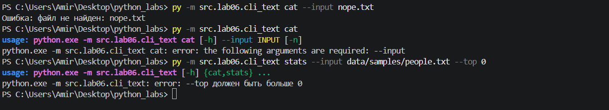

Нет входного файла → Ошибка: файл не найден: ... в stderr, код выхода 1.
Неверный формат или пустой файл (ValueError из ЛР5) → Ошибка: ... в stderr, код выхода 1.
Нет подкоманды или обязательного аргумента, --top 0, --top abc → parser.error(...): usage + сообщение, код выхода 2.
