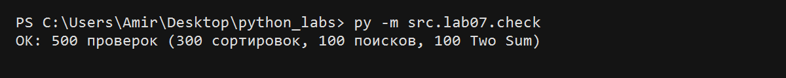
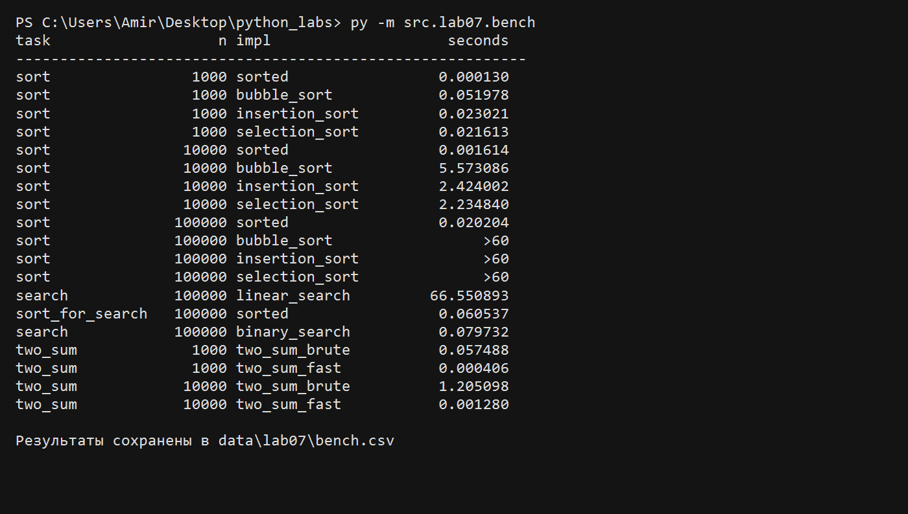

# ЛР7 — поиск, сортировка и бенчмарк

Реализованы линейный и бинарный поиск, два решения Two Sum, пузырьковая сортировка, сортировка вставками и выбором. Используется только стандартная библиотека Python; запись CSV выполняется функцией `write_csv` из ЛР4.


## Запуск

Команды выполняются из корня репозитория:

```bash
py -m src.lab07.check
py -m src.lab07.bench
```

Проверка использует `random.seed(42)` и выполняет 500 групп тестов: 300 сортировок, 100 поисков и 100 Two Sum. Бенчмарк создаёт общие наборы случайных данных в `data/samples/lab07/`, печатает таблицу и сохраняет полные значения в `data/lab07/bench.csv`.

## Результаты проверки

```text
OK: 500 проверок (300 сортировок, 100 поисков, 100 Two Sum)
```

Расхождений с эталоном не найдено, поэтому исправления после проверки не потребовались. Для каждой сортировки выполнено 100 случайных прогонов; дополнительно проверено, что исходный список не изменяется. Поиск проверен на присутствующих, отсутствующих и крайних элементах. Оба решения Two Sum либо возвращают корректную пару индексов, либо оба возвращают `None`.



## Таблица бенчмарка

Время указано в секундах. Каждый числовой результат — один замер через `timeit.timeit(..., number=1)`. Для поиска указано суммарное время 10 000 запросов к списку из 100 000 элементов. Сортировка перед бинарным поиском измерена отдельной строкой `sort_for_search`.

| task | n | impl | seconds |
|---|---:|---|---:|
| sort | 1 000 | sorted | 0.000130 |
| sort | 1 000 | bubble_sort | 0.051978 |
| sort | 1 000 | insertion_sort | 0.023021 |
| sort | 1 000 | selection_sort | 0.021613 |
| sort | 10 000 | sorted | 0.001614 |
| sort | 10 000 | bubble_sort | 5.573086 |
| sort | 10 000 | insertion_sort | 2.424002 |
| sort | 10 000 | selection_sort | 2.234840 |
| sort | 100 000 | sorted | 0.020204 |
| sort | 100 000 | bubble_sort | >60 |
| sort | 100 000 | insertion_sort | >60 |
| sort | 100 000 | selection_sort | >60 |
| search | 100 000 | linear_search | 66.550893 |
| sort_for_search | 100 000 | sorted | 0.060537 |
| search | 100 000 | binary_search | 0.079732 |
| two_sum | 1 000 | two_sum_brute | 0.057488 |
| two_sum | 1 000 | two_sum_fast | 0.000406 |
| two_sum | 10 000 | two_sum_brute | 1.205098 |
| two_sum | 10 000 | two_sum_fast | 0.001280 |

Значение `>60` является ограничением, предусмотренным заданием: квадратичные сортировки на 100 000 элементов не запускались, чтобы не выполнять три заведомо долгих замера. Это не измеренное время.



## Выводы

При увеличении `n` с 1 000 до 10 000 пузырьковая сортировка замедлилась с 0.051978 до 5.573086 секунды, то есть примерно в 107 раз. Это согласуется с квадратичной сложностью `O(n²)`: десятикратный рост размера даёт примерно стократный рост числа операций. У `sorted` время выросло с 0.000130 до 0.001614 секунды, примерно в 12 раз, потому что её сложность `O(n log n)` растёт почти линейно, а реализация оптимизирована. Сортировки вставками и выбором также показали квадратичный рост.

Бинарный поиск нельзя корректно применять к неотсортированному списку: после сравнения со средним элементом нельзя понять, в какой половине находится искомое значение. В замере 10 000 бинарных поисков заняли 0.079732 секунды, а предварительная сортировка — ещё 0.060537 секунды; вместе это намного быстрее 66.550893 секунд линейного поиска. Для одного запроса сортировка обычно не окупается, поскольку линейный поиск требует `O(n)`, а сортировка — `O(n log n)`. Она окупается при многократных запросах к неизменному списку: сортировка выполняется один раз, после чего каждый поиск стоит `O(log n)`.
