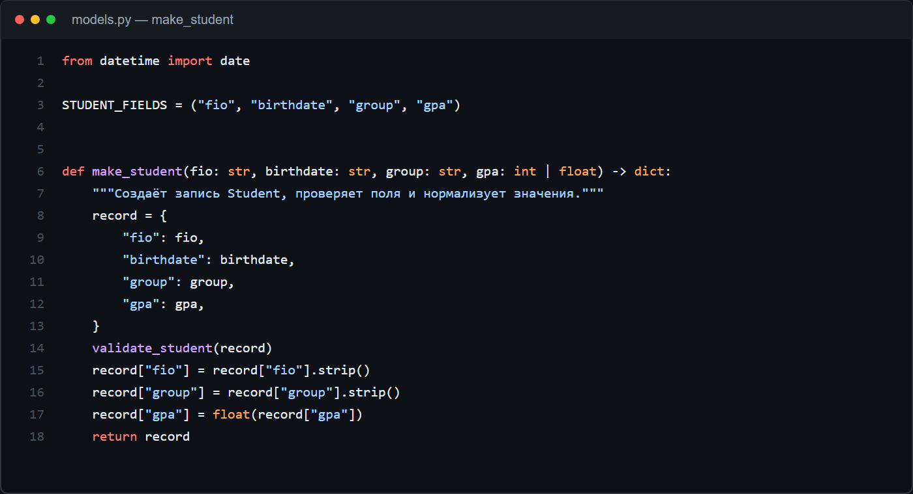
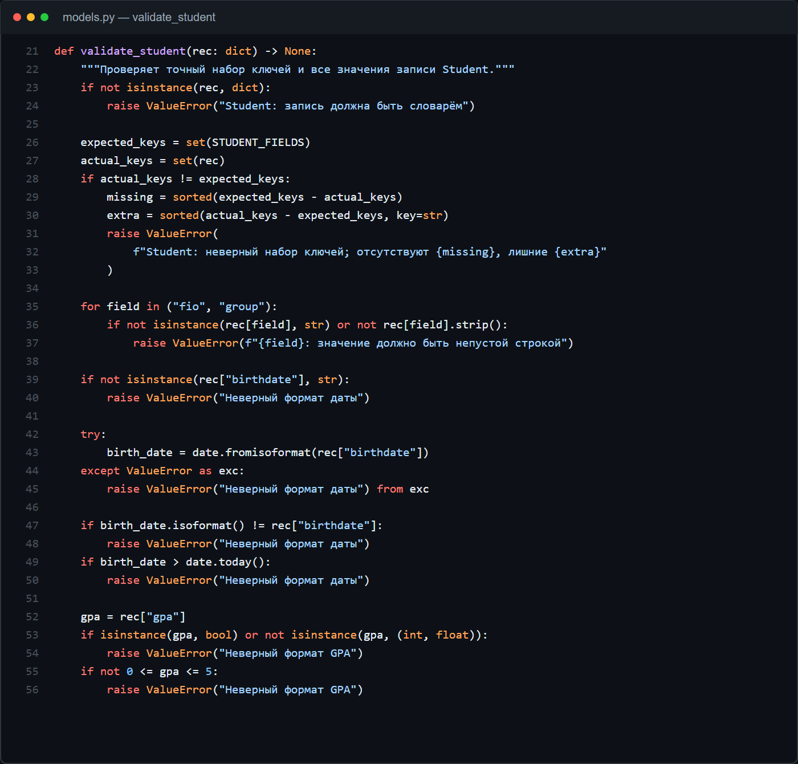
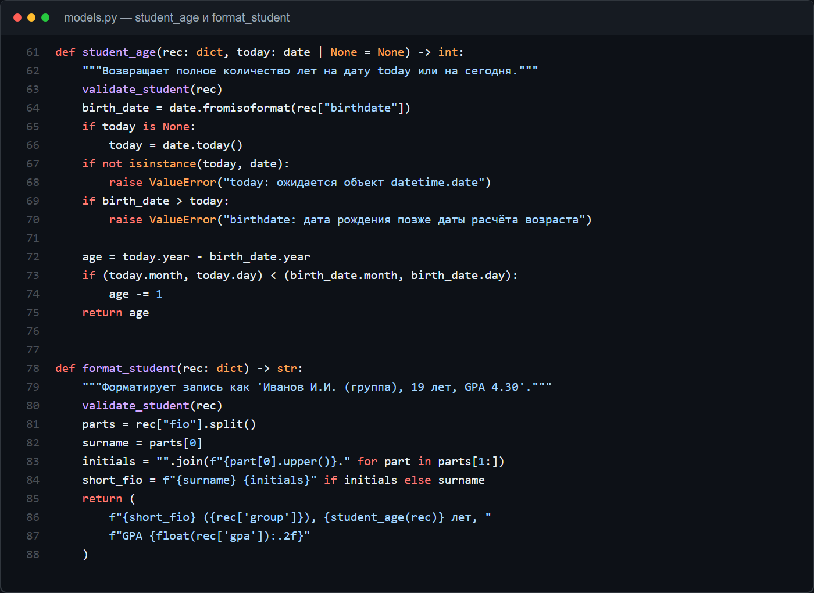
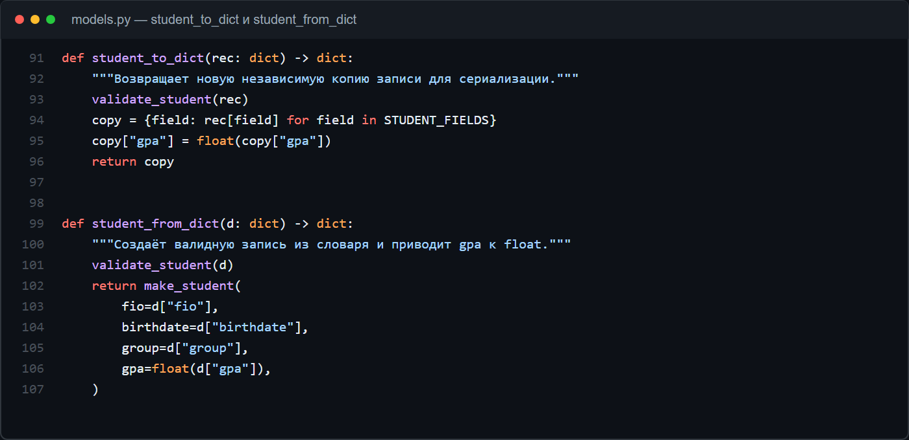
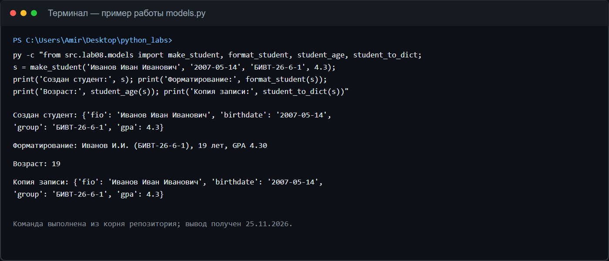
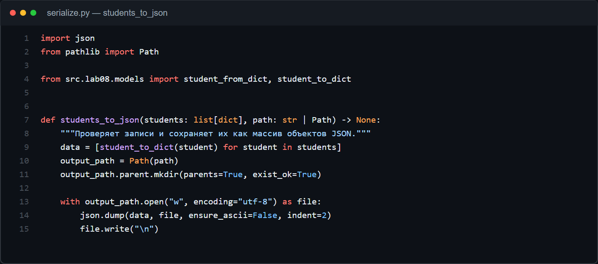
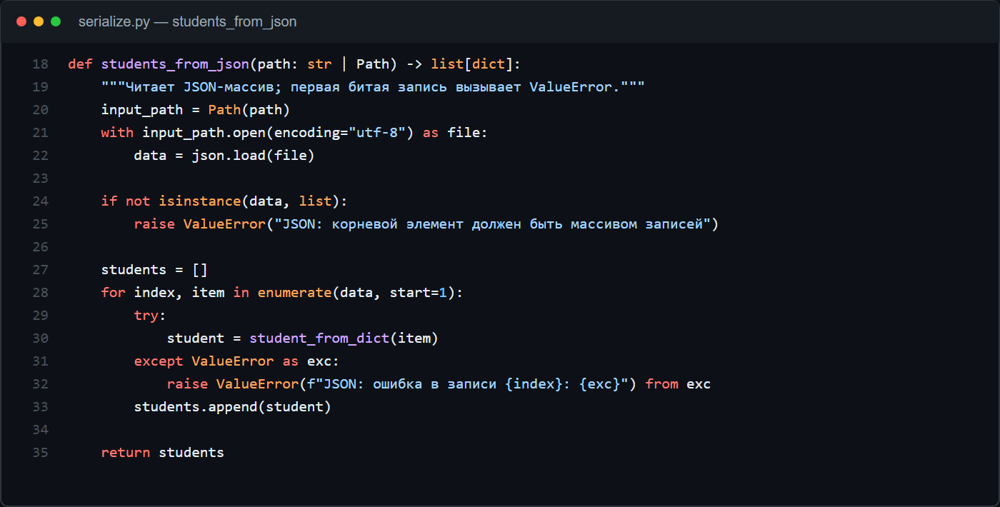
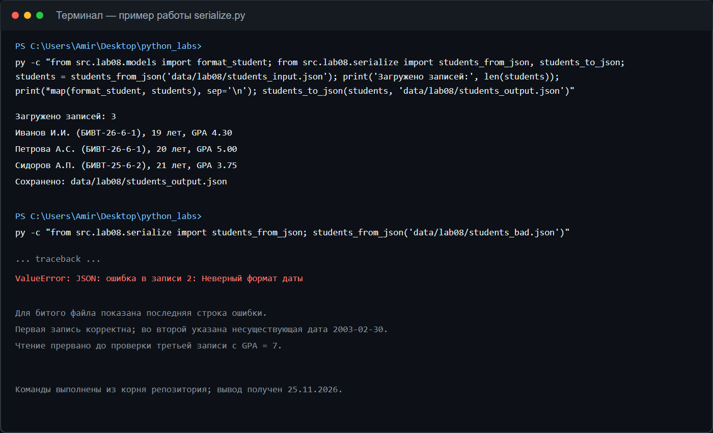

# ЛР8 — модель Student и JSON-сериализация

В работе реализованы модель студента, проверка входных данных, вычисление возраста, форматирование записи, а также чтение и запись JSON. Используется только стандартная библиотека Python.

Исходный код находится в `src/lab08/models.py` и `src/lab08/serialize.py`. Примеры входных и выходных файлов — в `data/lab08/`.

## Задание A — модель данных и функции (`models.py`)

Модель `Student` представлена словарём с фиксированным набором ключей `STUDENT_FIELDS = ("fio", "birthdate", "group", "gpa")`:

- `fio: str` — непустое ФИО;
- `birthdate: str` — существующая дата в формате `YYYY-MM-DD`, не в будущем;
- `group: str` — непустое название группы;
- `gpa: int | float` — средний балл от 0 до 5; `bool` не допускается.

### Конструктор записи — `make_student`

`make_student(fio, birthdate, group, gpa) -> dict` создаёт словарь и передаёт его на валидацию. После проверки удаляются крайние пробелы у ФИО и группы, а GPA приводится к `float`.



### Проверка данных — `validate_student`

`validate_student(rec) -> None` проверяет:

- тип записи и точное совпадение набора ключей со `STUDENT_FIELDS`;
- непустые строки ФИО и группы;
- формат и существование даты рождения;
- отсутствие даты рождения в будущем;
- тип GPA и его принадлежность диапазону от 0 до 5.

При неправильном GPA вызывается `ValueError("Неверный формат GPA")`, при неправильной дате — `ValueError("Неверный формат даты")`. Отсутствующие и лишние ключи также отклоняются.



### Возраст и строковое представление

- `student_age(rec, today=None) -> int` вычисляет полные годы на указанную дату или на сегодня. Если день рождения в текущем году ещё не наступил, из разности годов вычитается 1.
- `format_student(rec) -> str` возвращает запись в виде `Иванов И.И. (БИВТ-26-6-1), 19 лет, GPA 4.30`. GPA выводится с двумя знаками после запятой.



### Преобразование словарей

- `student_to_dict(rec) -> dict` валидирует запись и возвращает её независимую копию с GPA типа `float`, поэтому исходный словарь не изменяется.
- `student_from_dict(d) -> dict` проверяет входной словарь и создаёт из него новую нормализованную запись через `make_student`.



### Пример работы `models.py`

Команда выполняется из корня репозитория:

```bash
py -c "from src.lab08.models import make_student, format_student, student_age, student_to_dict; s = make_student('Иванов Иван Иванович', '2007-05-14', 'БИВТ-26-6-1', 4.3); print('Создан студент:', s); print('Форматирование:', format_student(s)); print('Возраст:', student_age(s)); print('Копия записи:', student_to_dict(s))"
```



Возраст вычисляется на дату запуска, поэтому в дальнейшем значение в выводе может измениться.

## Задание B — сериализация и обработка ошибок (`serialize.py`)

### Запись JSON — `students_to_json`

`students_to_json(students, path) -> None` проверяет и копирует каждую запись через `student_to_dict`, после чего сохраняет массив объектов в JSON.

Файл записывается в UTF-8 с параметрами `ensure_ascii=False` и `indent=2`: русский текст остаётся читаемым, а объекты форматируются с отступами. Родительская папка создаётся автоматически.



### Чтение JSON — `students_from_json`

`students_from_json(path) -> list[dict]` читает JSON-массив и преобразует каждый объект через `student_from_dict`. Если корневой элемент не является массивом, вызывается `ValueError`.



### Политика обработки битых записей

Выбрана строгая политика **strict**. Первая неверная запись прерывает чтение: вызывается `ValueError` с номером записи, начиная с 1, и причиной ошибки. Битые записи не пропускаются, а частично загруженный список не возвращается.

### Пример работы `serialize.py`

Чтение входного файла, форматирование записей и сохранение результата:

```bash
py -c "from src.lab08.models import format_student; from src.lab08.serialize import students_from_json, students_to_json; students = students_from_json('data/lab08/students_input.json'); print('Загружено записей:', len(students)); print(*map(format_student, students), sep='\n'); students_to_json(students, 'data/lab08/students_output.json'); print('Сохранено: data/lab08/students_output.json')"
```

Проверка файла с ошибками:

```bash
py -c "from src.lab08.serialize import students_from_json; students_from_json('data/lab08/students_bad.json')"
```

Последняя строка ожидаемой ошибки:

```text
ValueError: JSON: ошибка в записи 2: Неверный формат даты
```



В `data/lab08/students_bad.json` первая запись корректна, во второй указана несуществующая дата `2003-02-30`, а в третьей GPA равен `7`. Чтение прекращается на второй записи, поэтому до проверки третьей выполнение не доходит.

## Формат JSON

Входной файл `data/lab08/students_input.json` содержит массив объектов:

```json
[
  {
    "fio": "Иванов Иван Иванович",
    "birthdate": "2007-05-14",
    "group": "БИВТ-26-6-1",
    "gpa": 4.3
  }
]
```

Результат сохраняется в `data/lab08/students_output.json`. Значения полей сохраняются, а целочисленный GPA приводится к `float`: например, `5` сериализуется как `5.0`.
